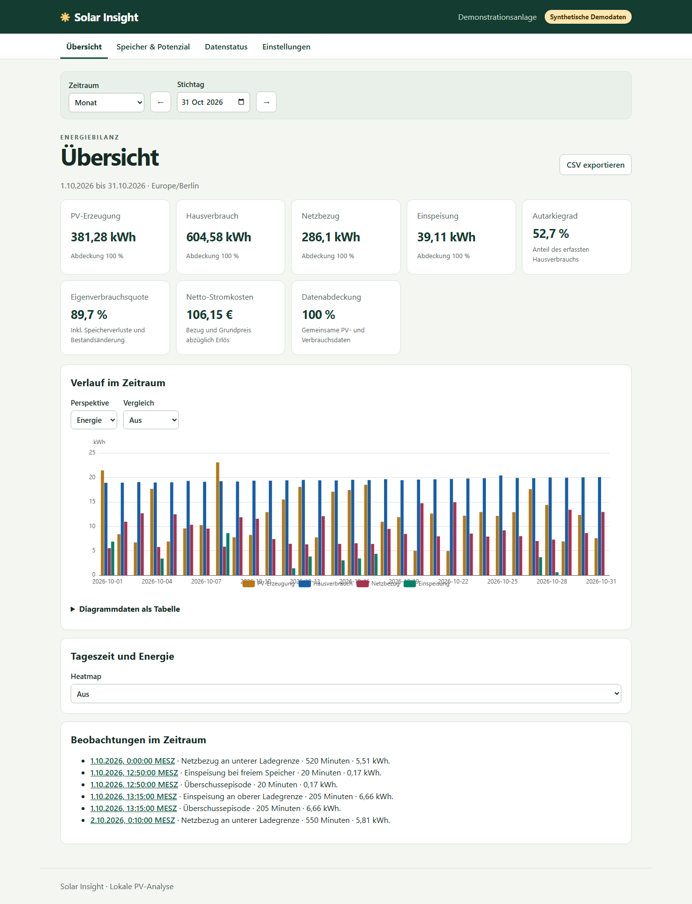

# Solar Insight

Selbst hostbare PV-Analyse mit ASP.NET Core, React, ECharts und PostgreSQL. Der Demo-Modus enthält 24 vollständige synthetische Monate in Fünf-Minuten-Auflösung. Analysen und Szenarien verwenden denselben serverseitigen Rechenkern. „Jetzt“, „Heute“ und die Live-Messpunktprobe verwenden dieselben Ansichten wie im privaten Betrieb und spielen einen gekennzeichneten synthetischen Demotag ab.



## Demo mit Docker Compose starten

Voraussetzung sind Docker mit Compose v2, etwa 4 GB RAM und zwei CPU-Kerne.

1. `.env.example` nach `.env` kopieren.
2. Den Ordner `secrets` anlegen. In `secrets/database-password` ein zufälliges langes Datenbankpasswort hinterlegen.
3. Im Projektverzeichnis starten.

```sh
docker compose up --build -d
docker compose logs -f app
```

Danach [Solar Insight öffnen](http://localhost:8080). Der erste Demo-Import benötigt typischerweise einige Sekunden. Sein Fortschritt ist unter Datenstatus sichtbar. Die Datenbank, Konfiguration und Schlüssel bleiben bei einem Neustart erhalten.

Die Beispielkonfiguration aktiviert ausdrücklich den öffentlich lesbaren Demo-Modus und erlaubt HTTP auf Loopback. Besucher können rechnen. Globale Tarife, Anlagenparameter, Providerzugang und echte Imports sind serverseitig gesperrt.

Eine Datei mit einem zufälligen Datenbankpasswort lässt sich unter PowerShell erzeugen.

```powershell
New-Item -ItemType Directory -Force secrets
$databaseBytes = New-Object byte[] 32
$databaseRandom = [System.Security.Cryptography.RandomNumberGenerator]::Create()
try { $databaseRandom.GetBytes($databaseBytes) } finally { $databaseRandom.Dispose() }
[IO.File]::WriteAllText((Join-Path $PWD 'secrets/database-password'), [Convert]::ToBase64String($databaseBytes))
Copy-Item .env.example .env
docker compose up --build -d
```

## Private Instanz einrichten

Für eine getrennte private Instanz einen eigenen Compose-Projektnamen und eigene Secret-Dateien verwenden. In deren Umgebung `SOLAR_DEMO=false` setzen. Ein neues lokales Passwort mit mindestens 14 Zeichen in `secrets/setup-password` hinterlegen. Den Secret-Ordner gegen andere lokale Benutzer abschirmen. Die Dateirechte müssen dem Containerprozess das Lesen erlauben.

```sh
docker compose -p solar-private -f compose.yaml -f compose.owner.yaml up --build -d
```

Die Passwortdatei wird nur beim erstmaligen Anlegen des Zugangs verwendet. Nach erfolgreichem Setup kann die Instanz mit der Basisdatei ohne das Setup-Secret weiter betrieben werden. Das Passwort bleibt als sicherer Hash im State-Volume. In Einstellungen lassen sich Anlage, historisch gültige Speicherparameter, Ereignisschwellen und Tarife pflegen. Ein Passwortwechsel beendet alte Sitzungen.

Zum ausschließlich lokalen Einrichten ist `SOLAR_ALLOW_HTTP=true` zulässig. Für den Betrieb hinter einem TLS-Reverse-Proxy wird dieser Wert auf `false` gesetzt. `SOLAR_TRUSTED_PROXY` muss die konkrete IP des eigenen Proxyservers enthalten. Der Proxy setzt `X-Forwarded-Proto: https` und leitet die Verbindung auf den Loopback-Port weiter. Das Cookie ist dann als Secure markiert. Provider-Callbacks und Requests mit Zugangsdaten dürfen im Reverse Proxy nicht protokolliert werden.

Ein minimales nginx-Beispiel für eine bereits eingerichtete TLS-Site ist in [docs/operations.md](docs/operations.md) enthalten.

## Sungrow anbinden

Der lesende Adapter verwendet dokumentierte EU-Open-API-Verträge. Die dokumentierte Anlagenstichprobe deckt Tageswerte und einen Teil der Live-Kanäle ab. Die vollständige Live-Abnahme A25 steht aus. Quellen, Stichprobe und offene Fragen stehen in [docs/provider-capabilities.md](docs/provider-capabilities.md).

1. Im Sungrow-Entwicklerportal eine OAuth-Anwendung anlegen und freigeben lassen.
2. Die vom Portal vorgegebene Einwilligungs-URL und eine eigene registrierte HTTPS-Rücksprungadresse verwenden.
3. Die App-Daten serverseitig als Secret-Datei `secrets/sungrow-app.json` bereitstellen.
4. Die private Instanz zusätzlich mit `compose.sungrow.yaml` starten.
5. In **Einstellungen → Verbindung** den einmaligen Autorisierungscode eingeben, die Anlage wählen und ihre vorausgefüllte Zeitzone prüfen.
6. **Anlage aktivieren**. Solar Insight plant den Rückimport automatisch ein. Unter **Datenstatus** stehen Fortschritt, letzter erfolgreicher Abruf und gegebenenfalls der nächste Schritt.
7. Für Minutenanalysen und Live-Kanäle ein bestätigtes [Betreiberprofil](docs/operations.md#betreiberprofil-für-messpunkte) hinterlegen. Für Simulationen sind gemeinsame PV- und Verbrauchszeitreihen und bestätigte Speicherparameter nötig.

Form der serverseitigen App-Datei, mit eigenen freigegebenen Werten auszufüllen.

```json
{
  "appKey": "<aus dem Entwicklerportal>",
  "accessKey": "<aus dem Entwicklerportal>",
  "redirect": "https://<eigene-registrierte-ruecksprungadresse>"
}
```

```sh
docker compose -p solar-private -f compose.yaml -f compose.sungrow.yaml up --build -d
```

Während der Erstinstallation zusätzlich `-f compose.owner.yaml` angeben. Die manuelle Codeübergabe ist eine dokumentierte Abweichung vom automatisierten OAuth-Weiterleitungsablauf. Sie benötigt einen vom Betreiber kontrollierten Empfang der registrierten Rücksprungadresse. Unterstützte State-/PKCE-Parameter sind für die konkrete freigegebene Anwendung noch zu bestätigen.

Solar Insight startet Provideraufrufe standardmäßig im Abstand von mindestens 15 Sekunden. Die Werte `SUNGROW_CALL_SPACING_SECONDS` und `SUNGROW_REFRESH_MINUTES` sind mit dem gebuchten Kontingent abzugleichen. Der Import fragt Tagesaggregate vor den Minutenwerten des jeweiligen Blocks ab. Ein Block umfasst bis zu 100 vollständige Kalendertage. Der Hintergrunddienst prüft abgeschlossene Tage und lädt gezielt fehlende Minutenfenster und Tagesaggregate nach. Importvorschau, Live-Anzeige und der optionale Heimnetz-Lesezugang sind in der [Betriebsdokumentation](docs/operations.md) beschrieben.

## Bedienung

- Übersicht bietet Energie, Kosten und Speicherperspektive, Vergleichsperioden, Tagesdetails und eine stundenbasierte Heatmap.
- Speicher & Potenzial enthält genau ein kombinierbares Szenario aus Speicheränderung, Verbrauchsverschiebung und Zusatzbedarf.
- Anfangsbestand, Endbestand, Messabweichung und Einschränkungen werden separat ausgewiesen. Ein größerer Speicher startet mit demselben absoluten Anfangsbestand.
- Nur Überschuss nutzen lässt nicht deckbaren Zusatzbedarf offen. Bedarf vollständig decken darf zusätzlichen Netzbezug verursachen.
- Exporte sind CSV für die aktuelle Auswertung und JSON für Simulationen inklusive Annahmen und Verschiebungsquellen.
- Die Amortisationsanzeige benötigt eine reine Speichererweiterung und zwölf vollständige, ausreichend validierte Monate mit vollständigen Tarifen.
- Änderungen an Tarifen oder Daten machen vorhandene Simulationsergebnisse ungültig.

## Entwicklung und Tests

```sh
dotnet restore src/Api/Api.csproj --locked-mode
dotnet build src/Api/Api.csproj -c Release --no-restore
dotnet test tests/Unit/Unit.csproj -c Release
# SOLAR_TEST_DB auf eine separate PostgreSQL-17-Testdatenbank setzen
dotnet test tests/Integration/Integration.csproj -c Release

cd src/Web
npm ci
npm run typecheck
npm run lint
npm run build
npx playwright install chromium --only-shell
npm run test:e2e
```

Playwright verwendet standardmäßig [die lokale Compose-Instanz](http://127.0.0.1:8080). `SOLAR_E2E_URL` kann diesen Wert ändern. Die private Sicherheitsprüfung benötigt zusätzlich eine getrennte private Testinstanz, `SOLAR_PRIVATE_URL` und eine nur lokal lesbare Passwortdatei in `SOLAR_TEST_PASSWORD_FILE`. Ohne diese Werte markiert Playwright genau diesen Test als übersprungen. Die CI setzt beide Werte.

Den Leistungscheck startet `node tests/E2E/performance.mjs` aus dem Projektverzeichnis gegen die laufende Demo.

Der vollständige Prüfstand und die einzelnen A01–A25-Kriterien stehen in [docs/implementation-status.md](docs/implementation-status.md). Die tatsächlich gemessene Performance steht in [docs/verification.md](docs/verification.md).

## Betrieb und Hintergründe

- [Backup, Restore, Updates und Fehlerdiagnose](docs/operations.md)
- [Architektur und Modellannahmen](docs/architecture.md)
- [Provider-Fähigkeiten und Quellen](docs/provider-capabilities.md)
- [Gepinnte Abhängigkeiten und Lizenzen](docs/dependencies.md)

Solar Insight steht unter der [MIT-Lizenz](LICENSE). Copyright © 2026 Frederik Thuss.

