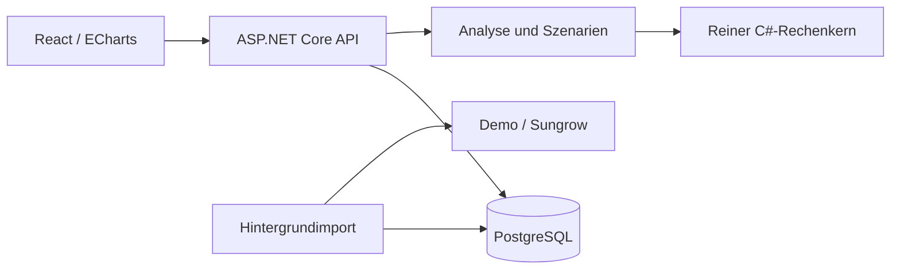

# Architektur und Betriebsannahmen

Solar Insight ist ein modularer Monolith mit vier C#-Projekten und einem React-Frontend.

## Verantwortung und Datenvertrag

- Domain enthält AC-Bilanz, Tarifregeln, Kalender und deterministische Lastallokation.
- Application enthält Demoquellen, Kennzahlen, Ereignisse, Validierung und kombinierte Potenziale.
- Infrastructure enthält EF Core, Migrationen, kanonische Messintervalle und die öffentlichen Sungrow-Leseverträge.
- Api enthält lokale Authentifizierung, CSRF-Schutz, isolierte Rechenjobs und Hintergrundimport.
- Web formatiert deutsche Texte und zeigt serverseitig berechnete Daten. ECharts lässt Reihen ausblenden und Tageskurven zoomen.

Messintervalle speichern UTC, Intervallenergie in kWh und SOC als Anteil. Die breite Tabelle Readings hält unabhängig nullable Kanäle auf einer gemeinsamen Zeitachse. Ihre Schlüssel entsprechen Anlage und Intervallbeginn. Endzeit und Quellsemantik ergeben sich aus der expliziten Adapterkonfiguration. Der Sungrow-Adapter fordert ein gemeinsames, vom Betreiber bestätigtes Raster von fünf oder 15 Minuten an. Eine feinere Auflösung wird aus Tagesaggregaten oder lückenhaften Reihen nicht erzeugt. Provider-Tagesaggregate liegen separat in Aggregates. Ergebnisse beziehen sich auf die Datenrevision der Anlage. Daten-, Tarif- und Konfigurationsänderungen erhöhen diese Revision. Der Ergebnisabruf verweigert veraltete Revisionen.

Das Datenmodell verwendet das Intervallmodell anstelle einer generischen Messpunkt-EAV-Tabelle. Dadurch sind gekoppelte Analysen und der gemeinsame Gültigkeitsbereich direkt abfragbar. Unbekannte Kanäle bleiben null.

Readings werden dauerhaft gehalten. Es gibt keine automatische Löschung von Messungen. Import und Upsert laufen in derselben Transaktion wie der Checkpoint. PostgreSQL-Advisory-Locks verhindern konkurrierende Fensterimporte derselben Anlage. Wiederholungen korrigieren bestehende Intervalle. Abgeleitete Aggregate werden bei Korrektur entfernt. Der technische Jobstatus bleibt nach einem Neustart erhalten. Rechenjobs sind kurzlebig, auf 32 Ergebnisse und zwei gleichzeitige Läufe begrenzt. Ein Besucher erhält höchstens einen aktiven Lauf. Rechenjobs werden bei neuen Aufträgen nach 30 Minuten bereinigt. Nach Prozessneustart werden Simulationen neu gestartet.

## Rechenkern

Der AC-Bilanzkern implementiert Abschnitt S-03 der Spezifikation. Speicherenergie wird oberhalb der unteren Reserve geführt. Ein bekannter Anfangsbestand ist absolut und in beiden Modellen gleich, soweit die Kapazität ihn aufnehmen kann. Unbekannte Segmentanfänge starten mit leerem nutzbarem Speicher. Der Endbestand wird ausgegeben und erzeugt keine realisierte Ersparnis.

Zusatzlast nutzt zuerst direkte PV nach dem Haushalt. Batterieentladung versorgt zuerst verbleibenden Haushaltsbedarf. Herkunft aus dem bekannten Anfangsbestand wird konservativ separat geführt. Überschuss-only verändert Batterie- und Haushaltsversorgung des identischen Szenarios ohne Zusatzlast nicht.

Die Verschiebung verwendet Schritte von höchstens 0,05 kWh, originale Quellbudgets und ein Ziel-Leistungsbudget. Quellen und Ziele sind zusätzlich durch modellierten Restbezug beziehungsweise Restexport begrenzt. Dadurch bleibt die Speicherbewegung bei einem Kandidaten rechnerisch gleich. Unter diesen Kandidaten entscheidet zuerst die größte Bezugsminderung, dann die Tarifkosten und dann die frühere Zielzeit. Vor Annahme berechnet der Kern den betroffenen Speicherverlauf bis zur Zustandsübereinstimmung erneut. Jeder angenommene Schritt muss den gesamten Netzbezug senken. Die Suche ist auf zwei Millionen Intervallbewertungen begrenzt. Das Ergebnis ist ein konservatives heuristisches Potenzial aus einem historischen Rückblick.

Die Tagesziele der Zusatzlast gelten für die ausgewählten lokalen Wochentage und Monatsfaktoren. Vollständige Deckung wird bei unzureichender verfügbarer Leistung oder vollständig fehlenden Tagen zurückgewiesen. Bei Überschuss-only bleiben fehlende und nicht deckbare Bedarfe ungedeckt.

Tarife verwenden Decimal. Negative Preise werden in Version 1 abgelehnt. Grundpreise gelten pro lokalem Kalendertag als Monatsbetrag / tatsächliche Monatstage. Fehlender optionaler Grundpreis bedeutet kein erfasster Grundpreis. Fehlende Import-/Exporttarife führen zu Teilbeträgen und verhindern Netto-Gesamtkosten.

## Qualitätsgrenzen

Reguläre Bewertung verlangt mindestens 95 % gemeinsame Abdeckung und höchstens 15 Minuten Auflösung. Die Referenzprüfung benötigt sieben vollständige Tage, höchstens 5 % normierten Import-/Exportfehler sowie SOC-MAE höchstens zehn Prozentpunkte. Ein fehlender SOC verhindert den Status eines validierten Speicherzustands. Datenlücken beenden Ereignisse und setzen den Speicher zurück. Statische Amortisation erfordert zwölf vollständige zusammenhängende Kalendermonate, vollständige Tarife, validierten SOC und eine reine Speichererweiterung.

Die Demo enthält November 2024 bis Oktober 2026 in Fünf-Minuten-Auflösung, mit Seed 17293. Deterministische Wetterfaktoren, Tageslicht, Morgen- und Abendlast erzeugen die Eingangskanäle. Der produktive Dispatch-Kern bilanziert Import, Export und SOC. Generatorregeln und numerische Referenzfälle werden separat getestet.

## Sicherheit

Die private Instanz verwendet ein sicheres PasswordHasher-Hashformat, HTTP-only-/SameSite-Strict-Cookies, CSRF-Token, Login-Limits und serverseitige Validierung. Der Initialzugang wird aus einer gemounteten Secret-Datei angelegt. Es existieren keine Standardzugangsdaten. Ein Passwortwechsel macht bestehende Sitzungen ungültig.

Provider-Schlüssel werden aus einer serverseitigen Secret-Datei gelesen. Zugriffstoken werden mit ASP.NET Data Protection verschlüsselt in PostgreSQL gehalten. Das Schlüsselvolume muss getrennt von einem Datenbankdump gesichert und auf dem Host geschützt werden. Schlüsseldateien sind standardmäßig durch Volume-/Dateisystemrechte geschützt. Für eine zusätzliche Verschlüsselung des Hosts oder seiner Backups ist der Betreiber zuständig. Die Anwendung loggt keine Request-Bodies und kein HTTP-Authorization-Material.

Es gibt keine externe Veröffentlichung durch Projektwerkzeuge. Compose bindet den App-Port an Loopback. Für einen externen Reverse Proxy sind HTTPS, exakte Proxy-IP und deaktiviertes Solar:AllowHttp erforderlich.

## Bekannte Grenzen der Providerverifikation

Die öffentlichen Leseverträge sind implementiert. Ohne freigegebene App und Eigentümerzustimmung ist keine Live-Verifikation möglich. Eine manuell bestätigte Zuordnung ist kein automatischer Beleg der physikalischen Richtigkeit. Die Inbetriebnahme verlangt eine autorisierte Messprobe.

Die OAuth-Einwilligungs-URL wird vom Entwicklerportal bereitgestellt. Der Betreiber verwendet die dort registrierte Rücksprungadresse und überträgt den einmaligen Code in das angemeldete lokale Formular. Es gibt keinen OAuth-Callback-Endpunkt in Solar Insight. Unterstützung von State/PKCE durch den konkreten Portalvertrag ist noch zu bestätigen. Diese manuelle Übergabe ersetzt in dieser Version die automatische Weiterleitung aus F-01.

Die historische API liefert lokale Zeitstempel. Die doppelte Herbststunde wird bei nicht eindeutigem Zeitstempel ausgelassen und als Abdeckungslücke sichtbar. Der aktuelle Tag wird historisch nicht abgefragt. Bei Momentanwerten kann das letzte Intervall vor dem aktuellen Tag mangels bestätigtem rechten Nachbarwert offen bleiben.

